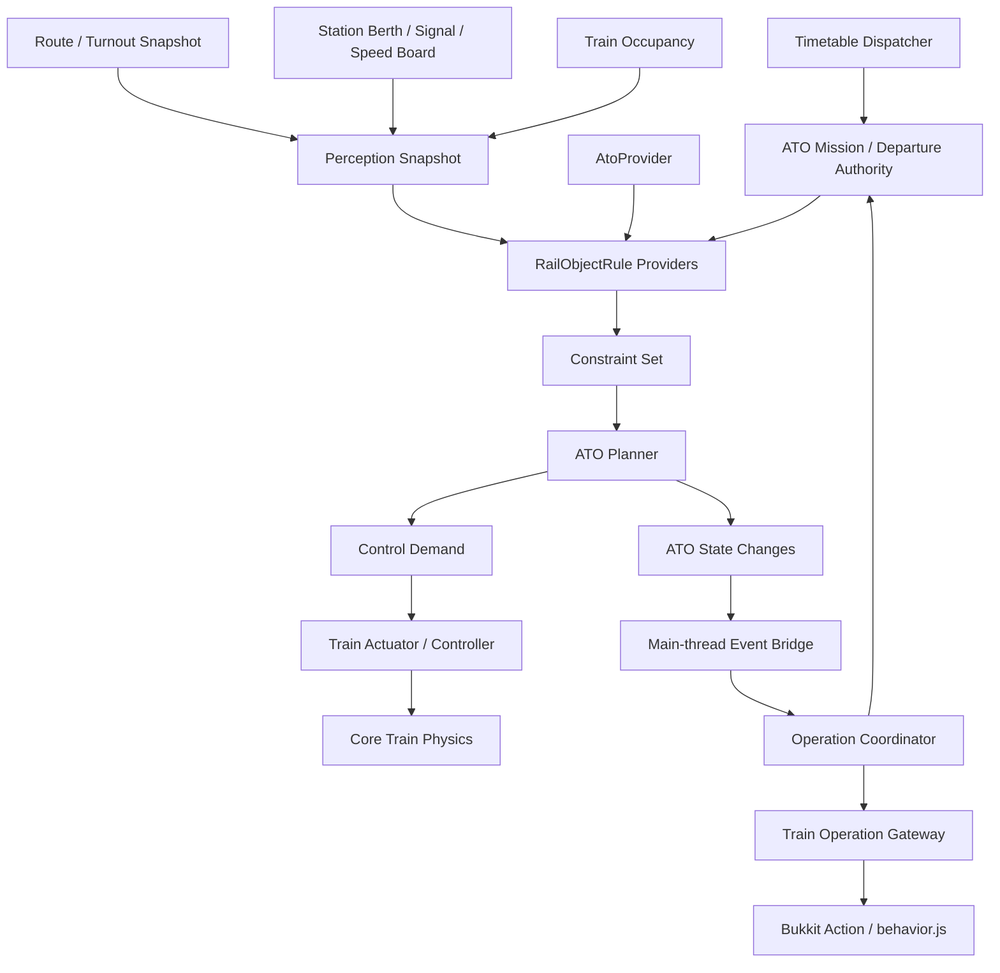
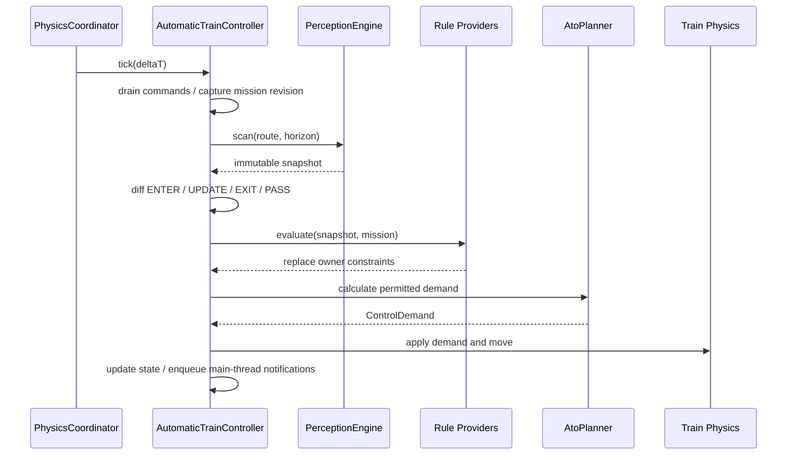
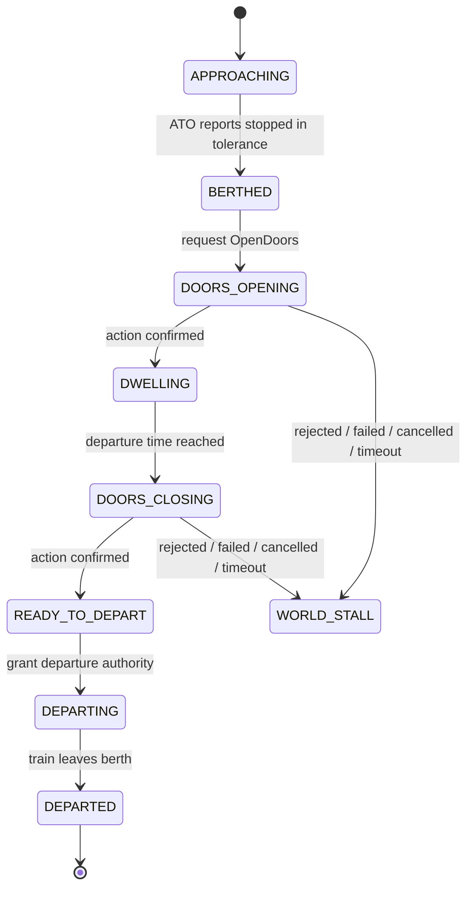

# 自动驾驶与运营协同设计

:::warning 实施状态
Phase A/B、C1 Mission、Phase C2 Station、Phase C3 车门操作网关、Phase D1 人工接管/重新规划、T1 完整周期时钟、T2 directed Destination、T3 Depot、T4 Reset 和 T5 人工被动进路已实现；当前继续实施给定时刻表运营闭环，插件 Registry 延期。未完成工作的顺序与边界见 [ATO 路线图](./ato-roadmap.md)。当前行为以源码、测试和 [API 状态](../extensions/api-status.md) 为准。
:::

## 当前实施状态

Phase A 已于 2026-07-14 落地以下基础契约：

- `MainThreadRailEvent` / `PhysicsRailEvent` 与两套带线程断言的同步事件总线；
- world 内稳定的 `RailObjectRef` 和 ACTIVE/REMOVED 生命周期；
- 不持有 live World/Rail/Train 的 Train、RailObject、Route、Perception 快照；
- 带严格单调 revision、拒绝旧命令的 `RevisionedCommandQueue`。

Phase B 已落地固定减速度约束计算、`AtoPlanner → ControlDemand → TrainActuator`、SimpleATO、前车跟随、目标与线路末端停车、可选单一信号 Provider，以及按 World 隔离的 ATO Stall。Stall 会自动写出结构化诊断，并通过 `/mr ato status|dump|reset` 由管理员处理；reset 不恢复列车位置。

Phase C1 已完成弧长加权 Dijkstra、经路/Mission 契约和原子 `RouteSectionAllocator`。显式列车 TimetableDispatcher 会从已发布的 head/tail 快照计算 route progress，按动态触发距离和时刻表优先级分配 Section，以 movement authority 保护未确认入口，只在车尾越过 release point 后释放，并可推进 dwell 和后续 Mission。SimpleATO 负责停车曲线和 Confirmed Route Window 验证；Bukkit 提供 start/status/stop 命令。

Phase C2.1 已增加 World-local StationStore、Station 聚合、被动 StationBerth RailObject、StationCall 和 DwellPlan 值。C2.2 已增加显式 berth/方向/长度解析、head-aligned Stop 与 DepartureHold，以及 physics 到主线程的 revisioned `APPROACHING`、`BERTHED`、`DEPARTED` 通知。C2.3 已接入 Dispatcher dwell/计划发车状态、后续经路确认、无抢占 berth 所有权和跨 Mission 车尾释放。JS/TypeScript 导航 DSL 使用 `[at(departureTick).]pass(...).destination(target, options?)`：显式计划 Tick 表示线路出发时刻，也可省略 `at()` 让 minimum dwell 决定最早发车。最终目标既可为普通 WayPoint，也可为 StationBerth Destination；两者都支持停车偏移、车门和 minimum dwell options，后者额外执行 StationCall。destination 到达后只开门，直到 minimum dwell 与下一次显式 `at` 都满足才关门；`reverse()` 保证先关门再交换运营头尾，`halt()` 在关门后执行模型包 `power-off` action。

Phase C3 已增加主线程 `TrainOperationGateway`、稳定 operation request、可轮询/取消 ticket、开关门状态和 Bukkit 模型适配。开门确认后开始 minimum dwell；关门确认和后续经路授权都满足后才解除 DepartureHold。操作 rejected、failed、cancelled、身份错误、Gateway 异常或 100 Dispatcher Tick 超时进入 `TrainOperationFailure` World Stall，不自动发车、恢复或释放资源。

Phase D1/T5 已把人工接管接入 Dispatcher：timetable 列车默认进入 `MANUAL_ROUTED`，解除旧 ATO 后由司机控制速度，而 Dispatcher 继续申请/释放计划 RouteSection；该模式不自动执行车门、dwell hold 或 departure grant。钥匙 UI 可显式关闭进路辅助并进入 `FULL_MANUAL/SUSPENDED`。驾驶权释放后统一进入 `REPLAN_REQUIRED`，管理员只能从明确 WayPoint/Destination 创建新 ATO/Mission revision。

下一目标由 [给定时刻表运营闭环设计](./timetable-operation-design.md) 固定：T1 已实现 `setPeriodDays`、共同 cycle-zero epoch、not-before、lateness 和 period 边界自动下一 cycle；T2 已增加普通/StationBerth/DepotStablingPoint 角色、严格接近方向、Station 多 berth 聚合和 legacy WayPoint adapter；T3 已完成 Depot/StablingPoint、RollingStockRecord、确定性动态配车、离库车尾释放，以及 `takeFromDepot`/`storeAtDepot` 的 reservation-to-occupancy/AVAILABLE 闭环；无匹配列车或空闲兼容停车点会 World-local Stall。T4 已增加 Stall-only 原子 Depot Reset、全量 preflight 和结构化报告；T5 已完成 MANUAL_ROUTED/FULL_MANUAL、保护点/经路/道岔安全监测和显式 replan 边界。T6 已统一 World-local Stall：door failure、基础设施消失、资源身份矛盾、脱轨和非法 controller replacement 使用稳定错误类别；正常冲突、晚点、计划等待和 loader failure 保持非 Stall。T7 已补齐多 cycle Depot→Station→Depot 自动矩阵、故障/人工/Reset 证据，并提供测试服游戏内验收清单。

## 1. 背景

Basic 模块计划提供基础自动驾驶能力，负责驾驶列车，并允许第三方插件接入不同的信号系统、移动授权算法和运营规则。时刻表调度器需要为列车选择 ATO 算法、下达运行任务，并在列车停站后协调开关门和定时发车。

当前源码已经具备部分基础设施：

- `TrainController` 由每个世界的 `PhysicsCoordinator` 在物理 worker 上执行；
- `RailLocationWithFacing` 可以沿当前有效经路查询信号和 `TrainEnd`；
- `CoreRail` 保存当前轨道上的信号和列车端部；
- `SweptOccupancyIndex` 提供按轨道弧长分桶的碰撞占用快照；
- Basic 已有 WayPoint、RoutePlanner、Timetable 数据模型、SimpleATO 和按 World 隔离的 TimetableDispatcher；
- Bukkit 层已经支持列车动作和 `behavior.js`，但这些操作属于平台主线程能力。

仍需处理的模型边界包括：Core 的轨道对象查询主要覆盖 Signal 与 TrainEnd，Basic 的 WayPoint 和 Provider Boundary 使用各自的 world-local store，道岔也不是 RailObject。因此不会把现有 `peekRailObjects()` 定义为公开 ATO 扩展协议。

## 2. 目标与非目标

### 2.1 目标

- 提供可运行的基础 ATO，实现线路限速、目标停车、前车防护和停站保持；
- 让信号插件通过组合式扩展接入，不要求继承并重写完整 ATO Tick；
- 允许时刻表以稳定 ID 选择 ATO 算法并提交不可变运行任务；
- 明确物理 worker 与平台主线程之间的数据和事件边界；
- 动态对象离开、销毁、转线或插件卸载后，相关约束能够自动清理；
- 为后续固定闭塞、移动闭塞、临时限速和不同车辆控制模型保留扩展点；
- 所有公开 API 明确单位、线程、所有权、快照语义和失败方式。

### 2.2 非目标

第一阶段不要求：

- 实现完整 ATP/联锁安全认证；
- 让第三方插件直接在物理 worker 上调用 Bukkit API；
- 把所有信号制式硬编码进 Basic；
- 让 Station 或其他 RailObject 直接操作列车模型和动画；
- 在同一接口中同时解决寻路、进路锁闭、车辆动力学和时刻表优化；
- 承诺文中草案的二进制兼容性。

## 3. 核心设计原则

### 3.1 感知、规则、规划和执行分离

ATO 不直接把“看见一个对象”翻译成任意列车动作。完整链路分为：

1. **Perception**：生成当前经路上的只读观察快照；
2. **Rule Provider**：把信号、前车、线路和任务解释为约束；
3. **Planner**：求所有约束下的允许速度或控制需求；
4. **Actuator / Controller**：根据车辆控制模型执行牵引、惰行和制动；
5. **Operation Coordinator**：在主线程处理开门、关门、广播和发车授权。

### 3.2 组合优先于继承

不同扩展轴彼此独立：

- ATO 驾驶算法决定速度曲线、舒适性和准点策略；
- 可选 `AtoProvider` 解释某种信号或移动授权系统；
- `RailObjectRule` 解释特定运营对象；
- 车辆 Actuator 处理不同牵引和制动模型。

不通过 `SimpleFixedBlockATO`、`ExpressCBTCATO` 等子类组合信号制式和驾驶算法，避免子类数量随功能组合增长。

### 3.3 快照是事实来源，事件是失效提示

安全相关状态必须在每个物理 epoch 通过一致快照重新确认。信号变化、道岔变化等事件可以使缓存提前失效，但不能成为唯一事实来源；遗漏事件不能让旧约束永久保留或让限制永久消失。

### 3.4 约束默认保守失效

- 外部 Provider 每 Tick 原子替换自己的约束；
- Provider 或 ATO 异常直接 Stall 当前 World 的全部 ATO，不实现自动恢复；
- 安全约束、运营约束和建议约束有不同所有者，普通插件不能删除不属于自己的约束。

## 4. 总体架构



Phase B 当前组合为：

```text
SimpleATO : AbstractATO : TrainController
  ├─ route/perception scan
  ├─ ConstraintManager
  ├─ AtoPlanner
  ├─ TrainActuator
  └─ optional per-train AtoProvider
```

Mission 和主线程 TimetableDispatcher 已在 Phase C1 落地；StationCall 通知与停站状态机属于 Phase C2，车门操作属于 Phase C3。信号插件通过 Provider 组合接入，不继承 SimpleATO。

## 5. ATO 控制器契约

### 5.1 `AbstractATO`

`AbstractATO` 固定执行规划、移动前验证、Actuator 和 World Stall 边界，并公开只读 `train` 与 `world`。Mission 不进入通用基类；当前由 SimpleATO 提供解析、revisioned queue 和 Tick 边界激活。ATO 生命周期状态尚未实现。

当前契约：

```kotlin
abstract class AbstractATO(
    train: Train,
    val world: World,
    actuator: TrainActuator,
    safetyProfile: AtoSafetyProfile,
    coordinator: AtoWorldCoordinator
) : TrainController(train, world) {
    final override fun tick(deltaTMillis: Double)
    protected open fun processPendingCommands()
    protected abstract fun plan(deltaTimeSeconds: Double): ControlDemand
    protected open fun validateBeforeMovement()
}
```

- `tick()` 只由 `PhysicsCoordinator` 在 physics worker 调用；
- 外部线程通过 revisioned command queue 提交 SimpleATO 命令；
- 未处理异常和移动前道岔矛盾进入所属 World 的 ATO Stall；
- 第三方信号逻辑使用 `AtoProvider`，不能覆盖完整 Tick 流程；
- SimpleATO Mission 在主线程解析并通过独立 revisioned queue 提交；
- controller 生命周期状态属于后续 Phase D。

### 5.2 每 Tick 流程



规划使用同一已发布 physics epoch 的状态。由于其他列车的位置可能相对当前计算落后一轮，制动模型必须包含至少一个 physics epoch 的反应时间和配置误差裕量。

## 6. RailObject 与感知模型

### 6.1 RailObject 不承担行为

RailObject 表示经路上的可定位对象，不直接调用列车动作。目标 API 至少需要稳定引用：

```kotlin
interface RailObject {
    val ref: RailObjectRef
    val lifecycleState: RailObjectLifecycleState
    val location: RailLocation
}

data class RailObjectRef(
    val namespace: String,
    val id: String
)
```

当前语义：

- ref 在单个 World 内必须唯一，跨 World 使用时必须同时携带 world ID；`RailObjectStore` 拒绝重复注册，`RailMap` 拒绝同一 RailView 内重复，ATO 在同一感知以及相邻 perception epoch 合并跨 view/index 对象时，若发现同一 ref 指向不同 live 对象，会以身份矛盾触发 World-local Stall，绝不静默覆盖；
- live RailObject 的 location 是实时视图，规划器只能消费 `RailObjectSnapshot`；
- 对象 owner 在移除时必须先发布 REMOVED，再从所属 store/index 解除注册；由 `RailObjectStore` 自身拥有的 provider boundary 由 store 完成该转换；
- 是否持久化由具体对象类型决定；
- `RailObjectSnapshot` 不伪造独立 revision；同一批感知的一致性由外层 `PerceptionSnapshot.perceptionEpoch` 以及 train/route revision 表达。对应 Stall JSON 从 `schemaVersion: 2` 起不再输出 subject `revision`。

不建议通过固定 `enum RailObjectKind` 封闭全部对象类型。信号、站台停车标等可以使用能力接口和 provider 注册扩展。

### 6.2 Station 与 Berth 分离

Station 是运营聚合体，可能包含多条轨道和多个站台，因此不强制 Station 本体只有一个 RailLocation。

```text
Station
  ├─ StationBerth A  -> RailObject
  ├─ StationBerth B  -> RailObject
  └─ metadata / default dwell policy
```

`StationBerth` 表示具体停车位置，可以包含：

- 经路位置；
- 默认停车偏移；
- 可用接近方向；
- 语义开门侧；
- 可容纳长度等站台约束。

C2 已确认把列车头部作为长期停车对齐参考点。停车偏移表示头部应停在 berth 标记之前的距离；不引入编组中心、指定车厢或驾驶室参考点。Station 是运营聚合体，StationBerth 是被动 RailObject，两者都不直接操作列车、约束、车门或道岔。第一版 StationCall 显式指定 berth，不自动选台。

### 6.3 Observation

感知结果必须携带经路距离，而不是只返回无序对象列表：

```kotlin
enum class ObservationTransition { ENTER, UPDATE, EXIT, PASS }

data class RailObservationSnapshot(
    val subject: RailObjectSnapshot,
    val transition: ObservationTransition,
    val routeDistanceMeters: Double,
    val relativeSpeedMetersPerSecond: Double?
)

data class PerceptionSnapshot(
    val epoch: Long,
    val train: TrainSnapshot,
    val route: RouteSnapshot,
    val observations: List<RailObservationSnapshot>
)
```

实现不应要求插件持有 `TrainEnd` 等内部对象。前车使用稳定的 `trainId`，必要时附加端部类型和只读运动快照。

### 6.4 扫描频率

动态安全对象应在每个 physics epoch 重新确认。前视距离建议至少为：

```text
serviceBrakingDistance
+ speed × reactionTime
+ configuredSafetyDistance
+ uncertaintyMargin
```

静态基础设施可以按 route revision 和 object index revision 缓存，但到目标的剩余距离仍要每 Tick 更新。

每 Tick 不做运行时反射。若保留 `@Observe` 语法，应在 provider 注册时解析一次，并转换为内部 typed handler。`@Observe` 只是便利层，不是感知存储和生命周期模型。

### 6.5 动态对象离开

PerceptionEngine 保存上一轮 subject 集合并与本轮快照做差：

```text
current - previous       => ENTER
current ∩ previous       => UPDATE
previous - current       => EXIT
跨越列车参考点           => PASS
```

因此前车驶出范围、转入其他分支、被销毁或与其他列车连接，都能在下一轮产生 EXIT。只有完整感知结果产生的 EXIT 才会移除对应跟车约束；感知过程抛出异常则直接触发 World-local Stall。

## 7. 约束模型

### 7.1 不把所有限制建模为全局 speed limit

当前约束接口和内建类型为：

```kotlin
sealed interface AtoConstraint {
    val key: ConstraintKey
    fun permittedSpeedMetersPerSecond(
        currentSpeedMetersPerSecond: Double,
        profile: AtoSafetyProfile
    ): Double
}

CurrentSpeedLimitConstraint
RouteSpeedLimitConstraint
StopConstraint
FollowConstraint
MovementAuthorityConstraint
DepartureHoldConstraint
```

Owner 由 `ConstraintManager` 的 owner-scoped 集合管理，不重复存入每个约束对象。

所有速度字段使用 `MetersPerSecond` 语义，距离使用米，时间明确使用毫秒、秒或 simulation tick，不能依靠方法名猜测单位。

### 7.2 最小允许速度

“所有限制取最小值”的原则保留，但取最小值的是每个约束在当前位置计算出的 `permittedSpeed`：

```text
finalPermittedSpeed = min(constraint.permittedSpeed(context))
```

例如 `StopConstraint` 不是创建时立即加入 0m/s 全局限速，而是在每 Tick 根据剩余距离和制动模型产生逐步下降的允许速度，到停车点附近才变为 0。

线路前方降速同理。只读取列车当前轨道的限速，会导致列车进入低速区后才开始制动，因此 `RouteSpeedLimit` 必须参与前视速度曲线。

### 7.3 Key 与所有权

当前使用 `ConstraintKey(namespace, value)` 和 `ConstraintOwner(type, id)`。`ConstraintManager.replace(owner, constraints)` 原子替换一个 owner 的完整集合；调用者不能通过该入口删除其他 owner 的约束。

SimpleATO 每 Tick 原子替换线路、线路末端、跟车和活动 Provider 的约束。Provider 切换时旧 Provider 集合先整体移除；插件卸载与活动实例迁移尚未实现，属于 Phase D。

### 7.4 停车目标

Phase B 的 `stopAt(key, RailObjectRef, offsetMetersBefore)` 在每 Tick 感知中解析剩余经路距离；offset 正值表示提前停车，参考点为列车头部。目标一旦被观察后发生 PASS 或 EXIT，会触发所属 World 的 ATO Stall，而不是静默解除停车约束。

WayPoint Mission 已在 C1 解析成带 route revision 的稳定停车目标。C2 将以相同边界解析 StationCall；StationBerth 停车参考点固定为列车头部，不改变现有 `RailObjectRef` 便利入口。

### 7.5 跟车约束

跟车不复用固定停车约束。当前 `FollowConstraint` 保存 route gap 和前车沿当前经路方向的速度；目标引用与 observation revision 由约束 key 和 PerceptionSnapshot 携带。安全间隔、反应时间和 service deceleration 来自 `AtoSafetyProfile`。

当前允许速度使用显式安全参数和 O(1) 固定减速度公式。坡度、jerk 或公开 `BrakeModel` SPI 暂不实施。

## 8. 插件扩展协议

### 8.1 `RailObjectRule`（Phase D 计划）

对象规则未来可把观察结果转换为约束，不直接移动列车，也不直接调用 Bukkit：

```kotlin
interface RailObjectRule<T : RailObject> {
    val supportedType: Class<T>

    fun evaluate(
        context: AtoEvaluationContext,
        observations: List<RailObservation<T>>,
        sink: ConstraintSink
    )
}
```

注册时应返回 `Registration`，用于插件卸载时取消注册和清理 owner 约束。

### 8.2 `AtoProvider`

SimpleATO 不依赖信号系统即可运行。每列车最多激活一个可选 Provider，它只在内建线路限速、停车和跟车约束之上贡献额外约束：

```kotlin
interface AtoProvider {
    val id: String
    fun constraints(context: AtoProviderContext): Collection<AtoConstraint>
}
```

方向感知的 `AtoProviderBoundary` RailObject 在列车 PASS 后原子激活或停用 Provider。找不到 Provider、返回错误 ID 或执行异常时，当前 World 的 ATO 子系统进入 Stall。固定闭塞和其他信号制式不需要继承 `SimpleATO`。

### 8.3 Provider 并发约束

- registry 保存 factory，SimpleATO 为每列车创建独立 Provider 实例；
- Provider 在 physics worker 上运行，必须非阻塞且不得访问 Bukkit API；
- Provider 需要主线程状态时，必须提前发布不可变快照；
- Provider 异常会被记录，并使所属 World 的全部 ATO 进入 Stall。

## 9. Mission 与时刻表

### 9.1 不使用 `Sequence<RailObject>`

Mission 在主线程提交时完成防御性复制、WayPoint 解析和 PlannedRoute 编译，不能把惰性 Sequence 或 live RailObject 跨线程交给 ATO。当前契约为：

```kotlin
data class AtoMissionRequest(
    val id: String,
    val revision: Long,
    val origin: WayPointRef,
    val points: List<AtoMissionPoint>
)

sealed interface AtoMissionPoint {
    data class Via(val target: WayPointRef) : AtoMissionPoint
    data class Stop(
        val target: WayPointRef,
        val offsetMetersBefore: Double
    ) : AtoMissionPoint
}

data class AtoMission(
    val id: String,
    val revision: Long,
    val origin: WayPointRef,
    val legs: List<AtoMissionLeg>
)
```

Resolver 失败区分 target unresolved 和 route unavailable；`SimpleATO.submitMission` 另行区分 accepted 与 stale revision。所有已接受命令在 physics Tick 边界只激活最新 revision。Reverse 和 Terminate point 尚未实现；StationCall 由独立的 C2 request/runtime 与 Mission revision 配对。

### 9.2 `StationCall`

C2 第一版的一次停站任务包含：

```text
callId
missionRevision
stationId
berthId                  # 必须显式指定
plannedArrival
plannedDeparture / minimumDwell
optional stopping offset # 相对列车头部
optional door side override metadata
```

Station 可以提供默认 dwell policy，但“本次列车停多久”的最终结果由时刻表显式值、车站默认值和计划发车时间解析为不可变 `DwellPlan`。自动选台、request-stop、skip 和能力驱动的车门策略不进入 C2。

### 9.3 调度器与 ATO 的边界

Timetable Dispatcher 负责：

- 选择列车和 ATO 类型；
- 构建、替换 Mission 和完整 Planned Route；
- 将连续道岔需求编译成原子 Route Section；
- 根据列车已发布位置动态分配、确认和释放 Section；
- 发布 Confirmed Route Window 与 movement/departure authority；
- 计算停站计划并协调开关门和发车时刻；
- 接收列车已停稳和已离开 Section 的状态。

ATO 负责：

- 服从 movement authority，在未确认 Section 的保护点前停车；
- 只验证 Confirmed Route Window 内的实际道岔分支；
- 不申请、不分配、不操作道岔，也不静默改道；
- 满足所有速度约束并准确停车；
- 停站期间保持 `DepartureHoldConstraint`；
- 报告 APPROACHING、BERTHED、DEPARTED 等状态。

调度器不按 Tick 直接设置列车速度，ATO 也不自行决定时刻表发车时间。

### 9.4 从时刻表推导道岔分配时机

时刻表只描述服务时间和 WayPoint 序列，不为每个道岔编写固定切换 Tick。Dispatcher 先将 WayPoint 之间的 Planned Route 展开为道岔需求，再按保护点划分 Route Section。一个 Section 内的全部道岔和冲突资源必须原子分配，避免部分占用和死锁。

实际分配由列车位置触发。保守触发距离至少为：

```text
Dtrigger = v² / (2a)
         + v × Tswitch
         + v × Treaction
         + Dmargin
```

其中 `v` 为接近线路允许速度，`a` 为 service deceleration，`Tswitch` 包含排队、设置和跨 physics epoch 确认时间。时刻表计划时间仅用于多个候选列车之间的优先级，不能作为安全相关切换的唯一事实来源。

Section 未确认时，movement authority 终止于入口保护点，SimpleATO 按正常停车曲线运行；这不是 Stall。分配成功后，Dispatcher 在 physics epoch 边界应用道岔状态并发布 Confirmed Route Window，SimpleATO 才验证并通过。已经确认的分支随后发生矛盾才触发 World-local ATO Stall。

Route 必须保持锁定，直到 TrainSnapshot 的 tail 完全越过 release point。第一版可把分配逻辑保留在 TimetableDispatcher 内部，未来再迁移到独立 RouteManager 或 Interlocking。

## 10. 车站动作与发车状态机

C2 建立了不含车门操作的停站、dwell、发车保持和车尾释放基础。Phase C3 已在该基础上实现以下主线程运营状态机：



平台相关操作通过语义网关执行：

```kotlin
fun interface TrainOperationGateway {
    fun execute(request: TrainOperationRequest): TrainOperationExecutionResult
}

sealed interface TrainOperation {
    data class OpenDoors(val side: DoorSide) : TrainOperation
    data class CloseDoors(val side: DoorSide) : TrainOperation
    data class SetCabLights(val enabled: Boolean) : TrainOperation
    data class Announce(val messageId: String) : TrainOperation
}
```

Bukkit 适配层将语义操作翻译为模型包 action 或 `behavior.js` 的 `door(side, scene)` 调用。ticket 在模型声明的所有延迟效果到达最晚启动时刻后确认；这是模型执行确认，不是独立车门传感器反馈。T6 已将关门未完成、动作失败、取消、超时或列车不支持能力统一为 World-local Stall，并保持 DepartureHold、berth 和已确认经路。完整证据见 [Phase C3 TrainOperationGateway 验收清单](./train-operation-validation-checklist.md)。

## 11. ATO Registry（Phase D 计划）

未来 Registry 保存可创建的算法类型，而不是正在运行的 ATO 实例。

```kotlin
data class AtoTypeId(val namespace: String, val value: String)

data class AtoDescriptor(
    val id: AtoTypeId,
    val displayName: String,
    val capabilities: Set<String>
)

interface AtoFactory {
    val descriptor: AtoDescriptor
    fun create(context: AtoContext, options: AtoOptions): AbstractATO
}
```

建议规则：

- ID 使用 `basic:simple`、`plugin:eco` 等稳定命名空间；
- 时刻表持久化 ATO ID 和版本化 options，不持久化 JVM Class 名；
- 重复 ID 注册失败；
- 注册返回可关闭的 `Registration`；
- 插件卸载时停止创建新实例，并对活动 controller 执行明确迁移或停车策略；
- 时刻表验证阶段检查所需 ATO 和 provider 是否可用；
- 缺失算法不能静默退回默认实现。

人工驾驶接管不能只替换 `CoreTrain.controller`。当前 D1/T5 行为会先通知 World-local Dispatcher；默认进入 `MANUAL_ROUTED`，由人工控制速度且 Dispatcher 继续整条 timetable 的经路申请，钥匙 UI 关闭辅助后才进入 `FULL_MANUAL/SUSPENDED`。驾驶权释放后进入 `REPLAN_REQUIRED`，系统不自动恢复旧 Mission，也不默认取消整条车次。管理员使用明确 WayPoint 触发 replan，目标固定为被中断 movement 的原目标，并生成新的 ATO 与 Mission revision。旧 RouteSection/StationBerth 在此期间继续按已发布车尾位置安全释放；资源未清空、列车未停止或不在指定 WayPoint 时 replan 失败。详细边界见 [运营闭环设计](./timetable-operation-design.md)，现有证据见 [Phase D1 控制权转移清单](./control-transfer-validation-checklist.md) 和 [运营闭环验收清单](./timetable-operational-closure-checklist.md)。

## 12. 线程与事件模型

### 12.1 两类事件

目标事件层次：

```kotlin
interface RailEvent
interface MainThreadRailEvent : RailEvent
interface PhysicsRailEvent : RailEvent
```

分别由两个发布入口接收：

```text
MainRailEventBus.publish(MainThreadRailEvent)
PhysicsRailEventBus.publish(PhysicsRailEvent)
```

不建议使用 `RailAsyncEvent` 命名，因为 physics event 是在物理 worker 上同步派发，不表示 EventManager 自动异步调度。

### 12.2 运行时约束

- Main bus 发布时断言当前为平台主线程；
- Physics bus 发布时断言当前为 physics worker；
- physics listener 必须非阻塞、线程安全且不能操作 Bukkit；
- 同一个 listener 可能被不同列车 worker 并发调用；
- 两类 bus 都应隔离第三方 listener 异常并记录 owner；
- 注册必须有作用域和可关闭 token，避免全局 listener 泄漏；
- per-train 观察不使用全局广播，否则列车数增加后可能形成 O(N²) 分发。

### 12.3 跨线程桥

物理事件需要被平台消费时，不直接把同一个可变事件实例切换线程。物理侧创建不可变 DTO，附带 world ID、train ID、epoch 和必要快照，再排入主线程：

```text
PhysicsRailEvent
    -> immutable notification DTO
    -> main-thread post-commit queue
    -> MainThreadRailEvent
```

主线程事件只能读取已发布状态。需要在当前 physics epoch 内影响决策的事件，例如同步移动授权或碰撞决策，必须留在 physics bus，不能等待 Bukkit 主线程。

## 13. 一致性、故障与安全策略

### 13.1 Route 一致性

Planned Route 表达时刻表期望的完整经路，Confirmed Route Window 只表达 Dispatcher 已原子分配并确认的当前 Section。SimpleATO 对未确认 Section 服从入口保护点的 movement authority，不把“尚未就绪”视为故障；它只在 Confirmed Route Window 内比较实际 RailView 分支。若已确认分支不符，或规划与移动之间发生变化，当前 World 的 ATO 子系统进入 Stall。Route/Mission revision 只拒绝新旧任务乱序，不作为世界拓扑真值。

### 13.2 异常处理

本项目不实现复杂的自动降级和错误恢复。ATO、Planner、Actuator 或活动 Provider 抛出异常时，`AtoWorldCoordinator` 将当前 World 的全部 ATO 置为 `STALLED`：

- ATO 停止规划和移动并将速度冻结为 0；
- 其他 World、手动列车和 Core 物理继续运行；
- 首个错误报告记录初始列车位置、当前 Train/Route/Perception 快照、Provider 和约束；
- 系统不会自动恢复，管理员恢复列车位置后显式 reset。

### 13.3 任务替换

Mission 替换必须带 revision，并在 physics tick 边界原子生效。旧 Mission 的停车保持和 provider 约束需要按 owner 一次性清理，不能逐条移除造成短暂无限制窗口。

### 13.4 Controller 生命周期

至少定义：

```text
CREATED -> ATTACHED -> ACTIVE -> SUSPENDED -> DETACHED -> CLOSED
```

列车销毁、脱轨、人工接管、插件卸载和世界关闭都必须收敛到明确状态，并释放 observer、constraint、event registration 和 operation ticket。

## 14. 性能策略

第一版可以使用当前 active route 上的局部扫描，但公开接口不绑定当前具体实现。实现演进方向：

1. 静态 RailObject 建立按 RailView 和弧长排序的索引；
2. route/object revision 未变化时复用静态候选；
3. 动态列车占用使用每个 physics epoch 发布的只读索引；
4. 在现有 swept occupancy 分桶基础上增加“沿经路查询最近占用”，而不是只支持 overlap；
5. 感知结果按 route distance 排序；
6. 复用内部缓冲区，避免每列车每 Tick 创建大量短命 list；
7. 使用现有 controller duration metrics 分别记录 perception、provider 和 planning 耗时。

安全相关动态扫描保持每 physics epoch 执行。只有静态候选发现和低优先级运营提示可以降低频率或事件驱动。

## 15. 实施顺序

Phase A/B 和 C1 Mission 垂直切片已完成。剩余工作拆成可独立验收的 Station、操作网关、插件生命周期和性能阶段，统一记录在 [ATO 路线图](./ato-roadmap.md)。C2 不混入完整车门状态机或复杂制动模型。

## 16. 验收场景

以下列表同时覆盖已实现基础和后续阶段；各阶段实际待办与验收归属见 [ATO 路线图](./ato-roadmap.md)：

1. 前车驶出前视范围后，下一 epoch 产生 EXIT，跟车约束自动移除；
2. 前车销毁、连接或转入其他岔路后，不保留悬挂约束；
3. 信号由允许变为禁止时，列车在移动授权终点前停车；
4. 信号恢复后，只有有效新授权才能解除保持；
5. `StopConstraint` 从远处生成制动曲线，而不是立即把全局限速设为 0；
6. 线路前方降速时，在进入限速区前完成减速；
7. Mission revision 乱序到达时拒绝旧任务；
8. Route Section 中的全部道岔要么原子分配成功，要么一个都不占用；
9. Section 未确认时列车在保护点前停车，不触发 Stall；
10. 车头通过但车尾尚未离开时不得释放 Section；
11. Confirmed Route Window 内实际分支错误或在规划期间变化时，当前 World 的 ATO 进入 Stall；
12. 同一 Provider 更新约束是原子的，不出现一 Tick 的无限制窗口；
13. Provider 抛出异常时当前 World 的全部 ATO Stall，其他 World 和非 ATO controller 继续运行；
14. 列车停稳后只触发一次 BERTHED，不重复开门；
15. 未确认关门完成时不解除 DepartureHold；
16. 人工接管时 ATO 停止输出，调度器收到状态变化；
17. physics listener 尝试调用 Bukkit 时被线程守卫拒绝；
18. 多个 ATO 和 Provider 注册使用命名空间 ID，不发生 key 冲突。

## 17. 未完成计划

未完成事项、阶段验收标准和开工前决策统一维护在 [ATO 路线图](./ato-roadmap.md)，避免本设计文档与任务列表重复并逐渐失真。Phase C2/C3/D1/T 的证据分别保存在 [Station 清单](./station-validation-checklist.md)、[TrainOperationGateway 清单](./train-operation-validation-checklist.md)、[控制权转移清单](./control-transfer-validation-checklist.md) 和 [运营闭环验收清单](./timetable-operational-closure-checklist.md)；Phase T 已完成，插件 Registry 与性能索引延期。
