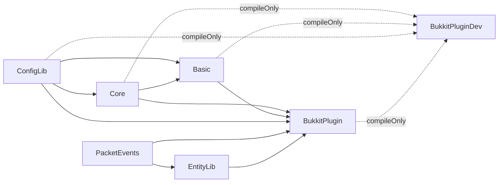

# 模块与依赖

## Gradle 模块

| 模块 | 当前职责 | JVM 目标 | 对外状态 |
|---|---|---:|---|
| `Core` | 平台无关物理模型、事件、Tick、持久化数据结构 | 17 | `core.api` 候选公开 API，其余为实现 |
| `Basic` | 曲线、寻路、运营和时刻表 | 17 | `basic.api` 候选公开 API，其余尚未稳定 |
| `ConfigLib` | kotlinx.serialization 持久化辅助 | 17 | 内部依赖 |
| `BukkitPlugin` | Paper 适配、模型、渲染、命令和交互 | 21 | 尚无独立稳定 Bukkit API 包 |
| `BukkitPluginDev` | 游戏内测试工具 | 21 | 仅开发使用 |
| `Annotation` | KSP 代码生成实验 | 17 | 当前未接入主构建流程 |

Paper 1.21.11 运行插件需要 Java 21。Core 和 Basic 保持 Java 17 字节码目标，但这不表示当前已经发布可独立消费的 Java 17 SDK。

BukkitPlugin 通过 `implementation` 将 PacketEvents 和 EntityLib 纳入 runtime/shadow classpath，并重定位其 package。管理员选择 `entitylib` 时，插件在 `onLoad`/`onEnable` 初始化 embedded runtime；轨道和列车视觉使用 packet-only Display，座位、交互与碰撞实体仍使用 Bukkit/Paper 原生实体。迁移边界见[展示实体渲染架构](rendering.md)。

## 编译期依赖



箭头表示被依赖模块指向使用方。例如 `Core --> Basic` 表示 Basic 依赖 Core。

## 包边界

计划公开的包必须显式列入 API Reference：

```text
work.art1st.mineRails.core.api.*
work.art1st.mineRails.basic.api.*
work.art1st.mineRails.bukkit.api.*    # 尚未建立
```

不能把 Kotlin/Java 的 `public` 等同于兼容承诺。当前若干候选 API 仍引用实现类，例如 `core.api.control.TrainController` 会使用 `CoreTrain` 和 `CommitBuffer`，这类泄漏需要在发布 SDK 前消除。

## 依赖规则

1. Core 不得依赖 Paper/Bukkit。
2. Basic 不应依赖 Core 实现包；现存例外属于待清理技术债。
3. 平台适配可以调用 Core 实现，但不应把实现类重新暴露给第三方插件。
4. 第三方插件最终应只依赖单独发布的 API artifact，而不是 `BukkitPlugin` fat jar。
