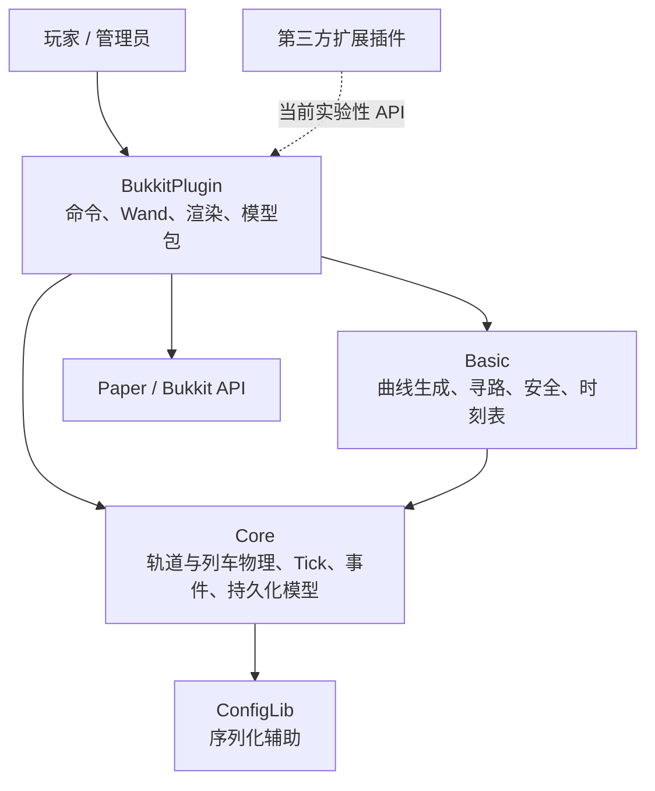
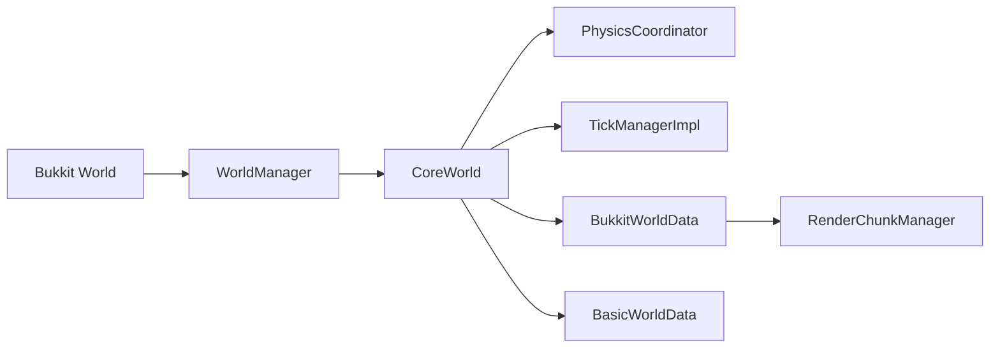

# 系统架构概览

MineRails 将连续轨道物理、铁路运营逻辑和 Paper 平台交互分层，目标是让 Core 和 Basic 将来可以脱离 Bukkit 独立运行。

## 分层职责

### Core

Core 定义轨道、列车、车厢、转向架、曲线、事件、Tick 和扩展数据等基础模型。`core.api` 试图形成平台无关接口，`core.physics` 等包保存当前实现。

Core 不应依赖 Bukkit。物理计算由每个世界自己的 `PhysicsCoordinator` 驱动，并与通用动画 Tick 分离。

### Basic

Basic 在 Core 之上实现基础铁路系统，包括曲线生成、轨道连接、寻路、速度安全和时刻表内部模型。每个 Core `World` 通过扩展数据挂载一个 `BasicWorldData`。

自动驾驶、信号扩展、停站动作和时刻表调度的目标边界见 [自动驾驶与运营协同设计](automatic-train-operation.md)。该页面目前是 Proposed 方案，不表示功能已经落地。

### BukkitPlugin

BukkitPlugin 是 Paper 适配层，负责：

- 插件生命周期和世界注册；
- 玩家命令、Wand 和 Dialog；
- Bukkit 实体渲染和分块可见性；
- 列车模型包、动作和行为脚本；
- 将 Core 世界快照写入插件数据目录。

### BukkitPluginDev

BukkitPluginDev 是游戏内测试和诊断插件，依赖主 MineRails 插件。它不是公开扩展 SDK，也不应作为 API 稳定性的依据。

## 每个 Bukkit 世界的运行时对象

`RailWorldFactory` 创建或恢复 `CoreWorld`，随后注册 Bukkit 和 Basic 的扩展数据、速度安全监控器以及轨道渲染信息，最后启动物理 Coordinator。

## 设计约束

- 非 Core 模块应优先依赖 `core.api`，当前仍有少量直接依赖内部实现的技术债。
- Bukkit API 只能在平台主线程调用；物理 worker 上的事件监听器必须线程安全。
- 配置、脚本和持久化数据必须显式报告损坏，不能静默替换为默认状态。
- `ai_tasks/` 中的目标设计可能早于或晚于当前实现，正式工程文档只描述已落地行为。
