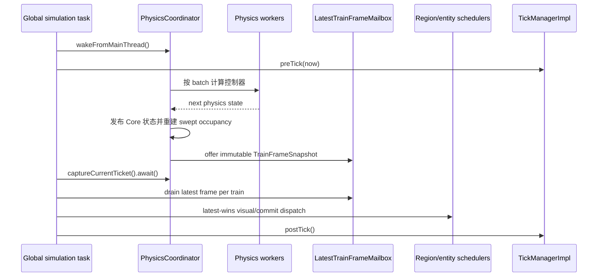

# 线程与 Tick 模型

MineRails 同时使用串行 simulation context、Folia global/region/entity scheduler、通用 Tick worker 和列车物理 worker。线程归属是扩展开发和故障排查时最重要的约束之一；Folia 下不存在可供所有 Bukkit 副作用使用的单一“主线程”。

## Server Tick 流程

`WorldManager` 使用 global scheduler 的 1-tick repeating task 驱动 simulation epoch，不再消费 Paper `ServerTickStartEvent/ServerTickEndEvent`。每次只捕获并等待当时的 physics ticket；不能在等待期间改为较旧 epoch，也不能在物理失败后提交旧状态。world load/unload、命令和 Wand 的 Core 变更通过同一可重入 simulation lock 串行化。等待 region operation 时会暂时释放该锁，region action 会重新取得锁，以避免跨 region 等待死锁。

## PhysicsCoordinator

每个 `CoreWorld` 有一个 Coordinator：

- 同时最多一个 in-flight epoch；
- 主线程和 fallback timer 的重复唤醒合并到同一个 ticket；
- worker 数由 `physics-worker-threads` 显式配置；
- 相邻 physics epoch 起点决定 `deltaT`，首个 epoch 使用 50 ms；
- 主线程 heartbeat 超过 75 ms 时，50 ms fallback timer 可以继续唤醒物理；
- 10 秒内 3 个 epoch 达到或超过 50 ms，Coordinator 进入 `STALLED`，不会自动恢复；
- `close()` 会停止 timer、Coordinator executor 和 worker pool。

## 发布与渲染

物理 worker 计算完后，Coordinator 统一发布列车状态并重建 swept occupancy，同时为每列车原子发布 value-only、带 revision/physics epoch 的 `TrainFrameSnapshot`。frame 不保留 live JOML、World 或 Bukkit 对象。

`CoreWorld` 使用有界 `LatestTrainFrameMailbox` 将 physics publisher 与平台 visual consumer 解耦：同一列车积压多帧时只保留最新 revision，stale frame 不能覆盖新状态，容量、合并和丢弃均有指标。因此渲染消费者暂停时不会形成逐 tick 无界 backlog，也不会阻止下一 physics epoch 发布。

`WorldManager` 在 global simulation task drain frame 后，按 frame 目标位置交给 region scheduler；`CarExtension.applyFrame()` 会断言 location ownership。`LatestAffinityTaskDispatcher` 对每个 car 只允许一个 in-flight task 和一个 latest pending frame，region 落后时不会形成逐 tick backlog。列车跨 region 时，revision guard 会拒绝乱序旧帧。旧的 `CoreWorld.commitPublishedTrainRenderState()` 和 `CoreTrain.commitRenderState()` 调用链均已移除；Core `commit()` 只更新 immutable publication，不再同步进入 Bukkit extension。`CoreCar`/`CoreBogie` 不再实现 generic `Synchronizable`，不能误入通用 platform commit mailbox。

Folia 会强制选择 EntityLib packet display backend，避免 native Display 实体跨 region teleport/remove。Interaction、seat carrier、platform collision 和 Wand marker 仍是原生实体：spawn 进入目标 location scheduler，后续 mutation/remove 进入 entity scheduler；跨 region movement 使用 `teleportAsync`，完成后再进入新的 entity owner。revision token 阻止异步 teleport completion 覆盖新位置。玩家距离与选择状态先在 player entity task 快照；native spawn task 只消费 activation/value state。

玩家受众更新使用 `RenderAudienceIndex` 的两组反向索引：chunk watcher 和 renderable 当前受众。车辆移动只检查新 chunk 的 watcher 与需要退出视距的旧受众；同一玩家积压的多个车辆位置按 renderable key 合并，由单个 entity task 批量 reconcile，不再形成 `car × world players` 次 scheduler submission。

## 通用 TickManager

`TickManagerImpl` 继续负责动画、延迟 action、速度安全监控等通用 `TickingObject`。它与列车物理 Coordinator 是两条独立调度路径，不应把列车控制器重新注册回通用 TickManager。

`Synchronizable` 对象的 `commit()` 已不再由 `TickManagerImpl.postTick()` 串行执行。worker 成功完成 `tick()` 后只向有界、按对象 identity 合并的 commit mailbox 发布请求；`postTick()` 负责等待 worker 和处理 simulation command queue。Bukkit `PlatformCommitAffinity` 为 animation/delayed action 提供 location，`WorldManager` 再通过 `LatestAffinityTaskDispatcher` 有界分派到 owning region。执行前若列车已跨 region，会重新解析 affinity 并迁移任务。`ActiveAnimation` 和 delayed action 的 worker tick/region commit 使用对象级同步，避免下一 worker tick 与滞后的 region commit 并发读写。

## 事件线程

MineRails 事件按线程归属分成两套同步总线：

- `MainRailEventBus` 只接受 `MainThreadRailEvent`；其 `ThreadGuard` 在 Bukkit 上代表串行 simulation context（Paper primary thread 仍兼容），不代表 Folia 任意 Bukkit 操作所有权；
- `PhysicsRailEventBus` 只接受 `PhysicsRailEvent`，发布时断言 MineRails async Tick worker；
- 两者都在调用线程立即执行监听器，不会自动调度，并逐个隔离监听器异常；
- 注册会返回可关闭的 `EventRegistration`，插件和服务必须在停止时关闭；
- 原 `EventManager` 仅保留为兼容 facade，新代码不再使用。

标记为 `@AsyncEventApi` 的物理事件要求监听器显式 opt-in 且保证线程安全。worker 监听器不得直接操作 Bukkit 实体、世界、玩家或 Dialog；需要通过明确的主线程提交边界转交。跨线程 payload 应使用 `TrainSnapshot`、`RailObjectSnapshot` 等不持有 live World/Rail/Train 的不可变值。

StationCall 通知在 physics 发布后由 simulation Dispatcher 消费。Phase C3 的 `TrainOperationGateway.execute()`、operation ticket 轮询/取消、controller transfer、release 和 replan 由 simulation context 串行协调；`behavior.js` 和模型 action 则通过 train-head region affinity 执行。operation request 只携带稳定 ID 和语义值，不会交给 physics worker。`SUSPENDED` 状态只读取完整 physics epoch 后已发布的 CoreTrain head/tail 位置来释放旧资源。

给定时刻表运营闭环继续由 World-local Dispatcher 在串行 simulation context 拥有 timetable epoch/cycle、Depot occupancy、RollingStock reservation 和 MANUAL_ROUTED 状态。确定性随机选择只能读取预解析 RollingStockRecord。Depot reset 必须先等待捕获的 physics ticket，完成全量预检后才能一次提交列车位置和资源账本；physics worker 不参与 Depot 分配或 Bukkit 配置读取。

## 平台调度

生产源码不再使用传统 `BukkitScheduler.runTask/runTaskTimer/runTaskAsynchronously`。不属于区域的协调 timer 使用 global scheduler，但 global task 只能做 simulation/value 协调；玩家 inventory、location、action bar、dialog 等访问必须再次进入 player entity scheduler。驾驶输入、列车钥匙扫描和 Wand 粒子均使用活跃玩家的持久 per-entity task/subscription，不做每 tick 全服 fan-out。`PlatformDispatcher` 在当前线程已拥有目标 entity/location 时直接执行，避免重复入队。位置相关的 block/world 操作使用 region scheduler，移动实体操作使用会跟随实体的 entity scheduler；跨 region native entity movement 必须使用 `teleportAsync`。

本地 Folia 测试使用 `./gradlew -PmineRailsFoliaSmoke=true :BukkitPlugin:runFolia`。该 Gradle property 只为 smoke artifact 临时生成 `folia-supported: true`；普通 build 仍生成 `false`，真实验证完成前不得修改生产默认值。Folia `26.1.2-8` 的空服 load/enable/disable smoke 已通过。测试 backend 使用支持 Minecraft 26.1.2 的 PacketEvents `2.12.1`，`runFolia` 会先把完整 shadow jar staging 到独立目录，避免 Folia 扫描正在生成的 `build/libs`。跨 region 功能和压力场景仍是发布前置条件。

## 代码约定

`@MainThread`、`@Heavy`、`@Concurrent` 等注解表达调用约束，但不是自动调度器。遗留 `ThreadGuard.ensureMainThread()` 在 Bukkit bridge 下只保证 simulation serialization；任何 Bukkit entity/location 副作用还必须使用 `BukkitThreadOwnership` 的 target-aware guard。新增 API 时必须在 KDoc 中说明调用线程、阻塞行为和状态何时可见。
