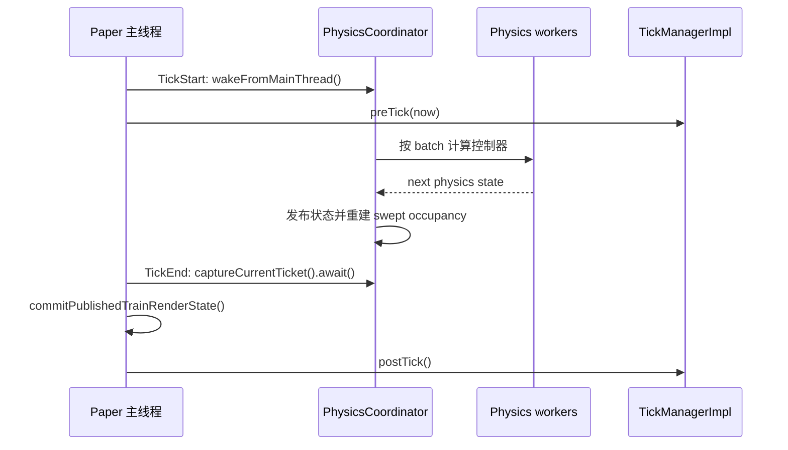

# 线程与 Tick 模型

MineRails 同时使用 Paper 主线程、通用 Tick worker 和列车物理 worker。线程归属是扩展开发和故障排查时最重要的约束之一。

## Server Tick 流程

TickEnd 只捕获一次当时的 physics ticket，并等待该 ticket。它不能在等待期间改为较旧 epoch，也不能在物理失败后提交旧状态。

## PhysicsCoordinator

每个 `CoreWorld` 有一个 Coordinator：

- 同时最多一个 in-flight epoch；
- 主线程和 fallback timer 的重复唤醒合并到同一个 ticket；
- worker 数由 `physics-worker-threads` 显式配置；
- 相邻 physics epoch 起点决定 `deltaT`，首个 epoch 使用 50 ms；
- 主线程 heartbeat 超过 75 ms 时，50 ms fallback timer 可以继续唤醒物理；
- 10 秒内 3 个 epoch 达到或超过 50 ms，Coordinator 进入 `STALLED`，不会自动恢复；
- `close()` 会停止 timer、Coordinator executor 和 worker pool。

## 发布与渲染

物理 worker 计算完后，Coordinator 统一发布列车状态并重建 swept occupancy。Bukkit 实体更新仍在主线程通过 `commitPublishedTrainRenderState()` 完成。渲染是否及时不会决定下一物理 epoch 能否读取已发布状态。

## 通用 TickManager

`TickManagerImpl` 继续负责动画、延迟 action、速度安全监控等通用 `TickingObject`。它与列车物理 Coordinator 是两条独立调度路径，不应把列车控制器重新注册回通用 TickManager。

## 事件线程

- `EventManager.fire()` 在调用线程同步派发，没有自动切换到 Bukkit 主线程。
- `EventManager.fireAsync()` 同样同步调用监听器，但调用线程是物理 worker，并逐个隔离监听器异常。
- 标记为 `@AsyncEventApi` 的事件要求监听器显式 opt-in 且保证线程安全。
- worker 监听器不得直接操作 Bukkit 实体、世界、玩家或 Dialog；需要通过明确的主线程提交边界转交。

## 代码约定

`@MainThread`、`@Heavy`、`@Concurrent` 等注解表达调用约束，但不是自动调度器。关键入口还会使用 `ThreadGuard` 做运行时检查。新增 API 时必须在 KDoc 中说明调用线程、阻塞行为和状态何时可见。
